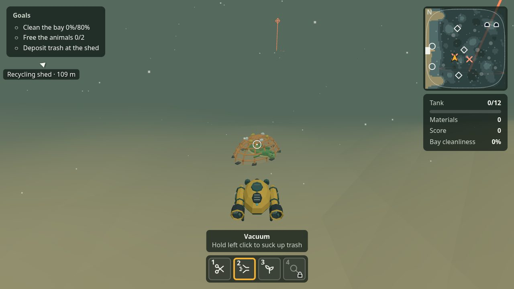
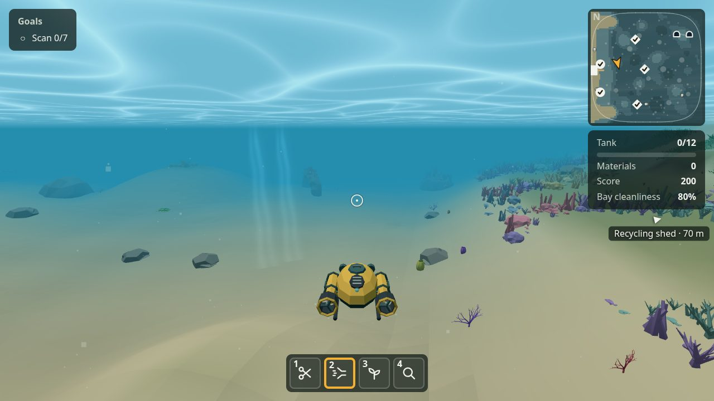
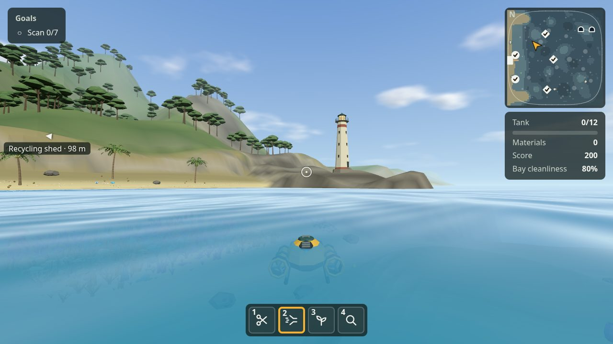

# ReefReviver

**Clean a polluted bay, rebuild its reef, and watch the sea come back to life.**

ReefReviver is a low-poly 3D game that runs in the browser, on a computer or on a phone or tablet held sideways. The player pilots a small crewed submarine through a murky tropical bay: vacuuming up trash and oil, cutting animals free from ghost nets, setting up reef frames and planting coral and seagrass. When the bay is clean enough and every site is planted, the water clears in the *Bloom*, sea life returns, and the player scans it into a Marine Logbook of sourced facts about SDG 14.

**Play it:** https://reef-reviver.vercel.app (no install; a recent Chrome, Edge or Firefox with WebGL 2)

*Bahasa Indonesia: [README.id.md](README.id.md)*

| Before: a turtle trapped in a ghost net | After the Bloom: the restored reef | The coast from the sea |
|---|---|---|
|  |  |  |

## Why: SDG 14, Life Below Water

Marine litter, abandoned fishing gear ("ghost nets") and damaged coral reefs and seagrass meadows are among the threats to ocean life that the UN's [Sustainable Development Goal 14](https://sdgs.un.org/goals/goal14) sets out to tackle. ReefReviver turns them into one short session that the player solves with their own hands: not a lecture, but a bay they clean and restore, and a reward of sea life and facts.

| SDG 14 target | In the game |
|---|---|
| **14.1** Reduce marine pollution, including marine debris | Trash on the sea floor, floating at the surface and lying on the beach; oil slicks; a boat that dumps trash into the bay. Collected trash is taken to a recycling shed on land and becomes building material. |
| **14.2** Protect and restore marine and coastal ecosystems | Steel-and-concrete reef frames planted with coral fragments, seagrass sown on the sand, and the Bloom that brings the bay back. |
| **14.4** End destructive fishing practices | Ghost nets that trap a green turtle and a blacktip reef shark, cut free with the Cutter. |
| **14.a** Increase scientific knowledge | The Scanner and the Marine Logbook: seven entries (green turtle, blacktip reef shark, clownfish, reef manta ray, spinner dolphin, coral, seagrass), each with facts, its SDG 14 target and the sources (IUCN, NOAA, FishBase, UNEP, the UN and others). |

## How it plays

1. **Clean up.** Vacuum the trash on the floor, at the surface and the oil slicks. When the 12-item tank is full, go ashore, walk to the recycling shed's counter and deposit it for materials. Pick up the trash on the beach on foot. Cut the ghost nets to free the turtle and the shark. Now and then a boat comes to dump more trash; a blinking marker points to it.
2. **Restore.** With the materials, set up reef frames at the three marked sites, then shoot coral fragments onto them and seagrass seeds onto two sandy patches with the Seed launcher.
3. **Bloom and scan.** Once the bay is 80% clean and every site is planted, the water turns clear, the corals take on colour and clownfish, yellowtail, manta rays and dolphins return. Scan them to fill the Marine Logbook; the seventh entry ends the session with a summary.

A full session takes about 10–15 minutes. The trash, nets and planting sites are laid out differently every session.

### Features

- A ±300 m bay with hills, valleys, boulders, rock arches, a cave lit by a shaft of light through its roof, a reef belt and seagrass meadows, open sea to the horizon with ships passing far out, and a beach with a timber recycling shed, a dock, palms and a lighthouse.
- Underwater and above water: the submarine floats at the surface, and the player can go ashore and walk on the beach in first person.
- Opening and Bloom cinematics, a mission card, a minimap, a tool hotbar, and markers that never cover the HUD.
- Sound: ambience, effects generated in code with the Web Audio API, and a CC0 music track.
- The mission card names SDG 14, and the end screen points to the real world: reefs and seagrass take years to recover, three things a player can do, and SDG 14 on the UN's website.
- English and Indonesian, switchable on the title screen.
- Touch controls on phones and tablets held sideways (joystick, drag to steer, USE button, tappable hotbar), with lighter rendering.

## Controls

| Keyboard and mouse | Action |
|---|---|
| W A S D | Move forward, back and sideways; on land: walk |
| Space / Shift | Rise / dive; Space all the way up floats at the surface |
| Mouse | Steer the submarine; on land: look around |
| Left click (hold) | Use the tool |
| 1 / 2 / 3 / 4 | Cutter / Vacuum / Seed launcher / Scanner (after the Bloom) |
| E | Set up a reef frame at a site, go ashore near the west beach; on land: pick up beach trash, deposit at the shed's counter, board the submarine |
| L | Open or close the Marine Logbook |
| M | Mute or unmute |
| Esc | Pause, or close the Logbook |

On a phone or tablet: the joystick (left half of the screen) moves, dragging on the right half steers, ▲/▼ rise and dive, USE uses the tool, the hotbar slots choose it, and E interacts.

## Technology

| Part | What it uses |
|---|---|
| Language and build | TypeScript, [Vite](https://vite.dev); a static build of about 3 MB |
| 3D | [Three.js](https://threejs.org) on WebGL 2. Every model (submarine, animals, coral, boats, buildings) is low-poly and built in code, then exported to glTF/GLB with `npm run generate:assets`; reefs, seagrass and beach decoration are instanced meshes; the sky, sea surface and surf are shaders |
| Sound | Web Audio API: effects and ambience generated in code, one looping music file |
| Tests | [Vitest](https://vitest.dev) unit tests (1,007) and [Playwright](https://playwright.dev) end-to-end tests (247, plus 7 against the production build) that play the game in a real Chromium on the GPU, including touch input as a phone |
| Hosting | [Vercel](https://vercel.com): every push to `main` is deployed |

Measured on a laptop with an NVIDIA GTX 1650 Mobile and an AMD Radeon Vega integrated GPU: 60 fps at 1280×720 and 1920×1080 in the busiest scenes after the Bloom, in Chromium and Firefox. On an Android phone: 60–90 fps (the screen's refresh rate).

## Getting started

You need [Node.js](https://nodejs.org) 22.12 or newer, an even version (22, 24, 26).

```sh
git clone https://github.com/ZeLzzzz/ReefReviver.git
cd ReefReviver
npm install
npm run dev        # development server; open the address shown in the terminal
npm run build      # type check + static build into dist/ (fails if dist/ is over 50 MB)
npm run preview    # try the build
```

To try it on a phone, run `npm run dev -- --host` and open the "Network" address on a phone on the same Wi-Fi. In the development server, `?fps` in the address shows the frame rate, and `?bloom` cleans and plants the bay as soon as the dive starts.

### Presenter mode (live demos)

A full session takes 10–15 minutes. For a short live demo, open the game with `?presenter` in the address, for example https://reef-reviver.vercel.app/?presenter (it works in the built game too). A tag in the bottom-left corner lists the keys. While playing:

- **P** finishes Phase 1 as if it had been played: the nets cut, the tank and free trash deposited at the shed until the bay is 80% clean, and the materials earned. Press **P** again to set up and plant every frame and patch: the Bloom and its cinematic begin.
- **B** calls the dumping boat right away (if none is in the bay and the Bloom has not begun).

The keys do nothing during cinematics, in the pause menu, the Logbook or the menus, and without `?presenter` nothing changes.

The build uses relative paths, so `dist/` can be served from any folder of a static host, such as Vercel or itch.io. Opening `index.html` straight from disk does not work, because browsers block module scripts on `file://`.

### Tests

```sh
npm test                        # unit tests (Vitest)
npx playwright install chromium # once, before the first end-to-end run
npm run test:e2e                # end-to-end tests in Chromium (Playwright)
npm run test:e2e:dist           # build, then play the build from a sub-folder
```

The end-to-end tests render WebGL on the GPU. On a computer without a usable GPU, run them with `E2E_SWIFTSHADER=1` to render on the CPU instead (much slower).

## Project structure

| Path | Contents |
|---|---|
| `src/config.ts` | Every tunable number: the bay's shape, speeds, fog, the Bloom, sea life, sound levels, touch controls |
| `src/game/` | The Three.js scene and the rules: terrain, submarine, land and walking, trash and vacuum, nets and animals, reef sites and seed launcher, the Bloom, scanner, the dumping boat, ships, session (tank, score, cleanliness, goals); `*-model.ts` files build the models |
| `src/ui/` | Screens and HUD: loading, title, credits, mission card, HUD and minimap, hotbar, pause menu, Marine Logbook, end screen, touch controls |
| `src/i18n/` | All in-game text, in English (`en.json`) and Indonesian (`id.json`) |
| `src/logbook/entries.ts` | The Marine Logbook's seven entries: scientific names, SDG 14 targets and sources |
| `src/audio/` | The Web Audio engine and the sound recipes |
| `public/assets/` | Exported GLB models, the music, and `manifest.json` (models listed there replace the ones built in code, so an artist's GLB can be dropped in) |
| `tests/unit/`, `tests/e2e/`, `tests/e2e-dist/` | Unit tests, browser tests, and tests of the build |
| `CREDITS.md` | The team, third-party assets and code with their licences (read by the in-game Credits screen) |

## Credits

Third-party assets and code, with their licences, are listed in [CREDITS.md](CREDITS.md), and shown on the in-game Credits screen. The background music is "Underwater Ambient Pad" by isaiah658 (CC0).
